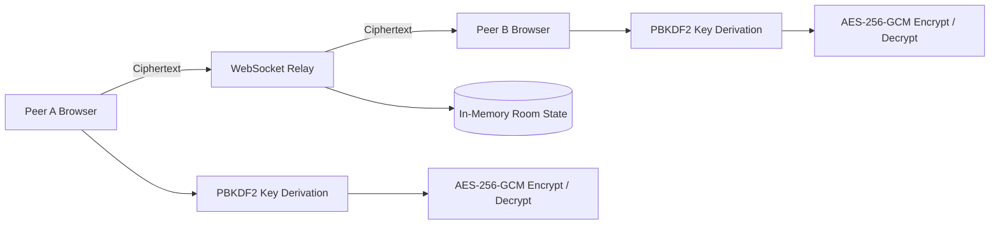
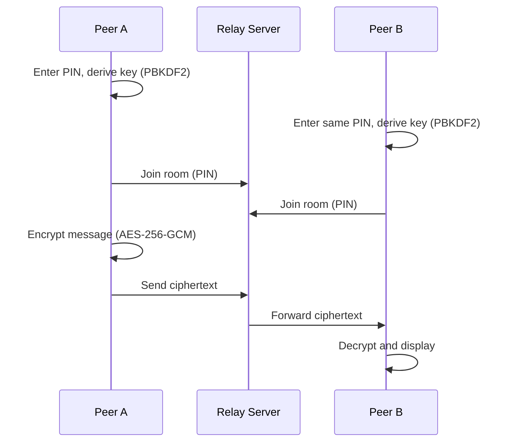

<p align="center">
  <strong>CipherLink</strong>
</p>

<p align="center">
  <a href="https://github.com/Devputta/Chart-in-IP-add/blob/main/QR%20for%20WEB/qrforge_1024px.png">
    
  </a>
</p>

<p align="center">
  <strong>
    A privacy-focused, accountless, two-person messaging application with
    client-side AES-256-GCM encryption, a stateless WebSocket relay, and
    ephemeral messaging, with no registration, no database, and no message logs.
  </strong>
</p>

<p align="center">
  <a href="https://github.com/Devputta/Chart-in-IP-add">
    
  </a>
  <a href="https://cipherlink-ly2c.onrender.com">
    
  </a>
  
  
  
  
  
  
</p>

---

## Overview

**CipherLink** is an accountless, ephemeral, two-person chat application that
encrypts every message in the browser before it touches the network.

Two participants agree on a shared 3 to 6 digit PIN. Each browser independently
derives the same 256-bit AES-GCM key from that PIN using PBKDF2 through the Web
Cryptography API. The backend is a minimal WebSocket relay that forwards
ciphertext between two clients in the same room. It has no user accounts, no
database, no message logs, and no access to encryption keys.

Live demo: https://cipherlink-ly2c.onrender.com

---

## Key Features

### Client-Side Encryption

* AES-256-GCM authenticated encryption
* PBKDF2-HMAC-SHA-256 key derivation (120,000 iterations)
* Domain-separated salt
* Unique 96-bit initialization vector per message
* 128-bit authentication tag
* All cryptography performed locally through the Web Cryptography API

### Accountless Access

* No sign-up, login, or personal data collection
* Rooms are matched solely by the shared PIN
* Strict two-party rooms; additional peers are rejected with a `room-full` error

### Encrypted Media and Messaging

* Encrypted text messages
* Encrypted image, video, and PDF sharing
* Sender-side message deletion
* Self-destruct timers (30 seconds and 5 minutes)

### Zero Persistence

* No database and no disk writes
* Room state is held in server memory only and removed when both peers disconnect
* Plaintext and keys exist only in browser memory

### Interface

* Responsive React interface
* Animated chat bubbles and composer
* Web Audio API sound effects with no external audio files

---

## How It Works

1. **Key Derivation.** The browser runs PBKDF2-HMAC-SHA-256 with 120,000
   iterations and a domain-separated salt to produce an AES-256-GCM key.
2. **Client-Side Encryption.** Each message, image, video, or PDF is encrypted
   in memory with a unique 96-bit IV and a 128-bit authentication tag before
   transmission.
3. **Relay.** The WebSocket server (`server.ts`) reads only the room PIN to pair
   two peers. It handles opaque ciphertext and cannot decrypt it.
4. **Zero Persistence.** When both peers disconnect, the in-memory room object
   is deleted. Nothing is written to disk.

### Architecture



### Message Flow



---

## Technical Stack

| Layer          | Technology                                      |
| :------------- | :---------------------------------------------- |
| Frontend       | React, TypeScript, Vite                         |
| Backend        | Bun runtime, Express, WebSocket (`/ws`)         |
| Cryptography   | Web Cryptography API (AES-GCM, PBKDF2)          |
| Audio          | Web Audio API                                   |
| Deployment     | Render (blueprint included), Docker, or any VPS |

---

## Getting Started

### Prerequisites

* [Bun](https://bun.sh/) 1.0 or newer

### Installation

```bash
git clone https://github.com/Devputta/Chart-in-IP-add.git
cd Chart-in-IP-add
bun install
```

### Run in Development

```bash
bun dev
```

The application starts at `http://localhost:3000`.

### Test a Conversation

1. Open `http://localhost:3000` in two separate browser tabs or windows.
2. Enter the same PIN in both (for example, `4829`).
3. Send a message from the first tab; the second tab decrypts and displays it.

### Other Commands

```bash
# Type check
bun run lint

# Production build
bun run build

# Start production server
bun run start
```

### Environment Variables

Copy `.env.example` to `.env` and adjust values as needed. By default the
server listens on `process.env.PORT`, falling back to `3000`. Never commit
real secrets to source control.

---

## Deployment

CipherLink is a unified full-stack application. `server.ts` serves the compiled
Vite frontend and handles WebSocket connections on `/ws`.

### Hosting Requirements

* **Persistent process required.** The backend needs a runtime that supports
  long-lived WebSocket connections. Render, Railway, Fly.io, Docker containers,
  and standard VPS hosts all work.
* **Serverless is not supported for the backend.** Platforms such as Vercel
  Functions or AWS Lambda cannot maintain persistent WebSocket servers. To host
  the frontend on such a platform, run `server.ts` separately on a persistent
  host and point the WebSocket client to it.

### Production

```bash
bun run build
bun run start
```

A `render.yaml` blueprint is included for deployment on Render. See
[DEPLOYMENT.md](DEPLOYMENT.md) for details.

---

## Repository Structure

```text
CipherLink/
├── server.ts            Express server and WebSocket relay (/ws)
├── index.html
├── package.json
├── tsconfig.json
├── vite.config.ts
├── render.yaml          Render deployment blueprint
├── .env.example
├── DEPLOYMENT.md
├── SECURITY.md
├── LICENSE
├── LICENSE.md
├── README.md
├── public/              Static assets
└── src/
    ├── crypto/          AES-GCM and PBKDF2 cryptography
    ├── components/      Views, chat bubbles, composer, animations
    ├── types/           Message and protocol type definitions
    ├── utils/           Web Audio effects
    ├── App.tsx          Application state and session management
    └── main.tsx         React entry point
```

---

## Security

Security considerations and the vulnerability reporting process are documented
in [SECURITY.md](SECURITY.md). Please report vulnerabilities privately rather
than through public issues.

### Known Limitations

* **Short PIN entropy.** A 3 to 6 digit PIN offers between 1,000 and 1,000,000
  combinations. PBKDF2 slows offline guessing and the relay rate-limits joins,
  but the PIN is intended for casual rendezvous, not for resisting a dedicated
  adversary. Use a longer PIN for sensitive conversations.
* **Screenshots and screen capture.** Deletion and self-destruct timers remove
  messages from browser memory, but cannot prevent the other participant from
  capturing the screen or copying content.
* **Volatile memory.** Keys and plaintext exist only in browser RAM. Refreshing
  or closing the tab permanently erases the conversation. There is no backup,
  history, or multi-device sync.
* **Strict two-party cap.** Each room allows exactly two peers. CipherLink is
  intentionally not a group chat system.
* **In-memory server state.** If the relay restarts, active connections drop
  and both peers must reconnect.

This software has not undergone an independent security audit. Do not rely on
it as the sole protection for highly sensitive communications.

---

## Ownership and Rights

Copyright (c) 2026 Devputta. All rights reserved except as expressly granted
by the license below.

* **Authorship.** CipherLink, including its source code, documentation, design,
  and repository content, was created and is maintained by
  [Devputta](https://github.com/Devputta).
* **License terms.** The software is distributed under the MIT License. Use,
  copying, modification, and distribution are permitted only in accordance with
  that license, which requires that the copyright notice and permission notice
  be retained in all copies or substantial portions of the software.
* **Attribution.** Any redistribution, fork, or derivative work must preserve
  the original copyright and license notices and must not misrepresent the
  origin of the software.
* **No misrepresentation.** Removing or altering authorship, copyright, or
  license notices, or presenting this work as your own original creation, is a
  violation of the license terms and of the author's rights.
* **Name and branding.** The project name, logo, screenshots, and visual
  identity may not be used to imply endorsement by, or affiliation with, the
  author without written permission.
* **Enforcement.** Unauthorized use, plagiarism, or removal of attribution may
  result in takedown requests (including DMCA notices to GitHub and hosting
  providers) and other legal action permitted by applicable law.

To report suspected misuse or to request permission for uses outside the
license, contact the author through
[github.com/Devputta](https://github.com/Devputta).

---

## Disclaimer

This software is provided "as is", without warranty of any kind, express or
implied. The author is not liable for any claim, damages, or other liability
arising from the use of this software. Users are responsible for complying with
the laws and regulations that apply to encrypted communications in their
jurisdiction.

---

## License

This project is licensed under the **MIT License**. See [LICENSE.md](LICENSE.md)
for the complete license text.

## Legal

* [License (MIT)](LICENSE)
* [Copyright Notice](COPYRIGHT.md)
* [Disclaimer](DISCLAIMER.md)
* [Security Policy](SECURITY.md)

<p align="center">  <a href="https://github.com/Devputta/Drafts-might-be-needed-/blob/main/LOGO/Gemini_Generated_Image_1ppnm1ppnm1ppnm1%20(1).jfif" target="_blank" rel="noopener noreferrer">      </a></p>


---

<p align="center">
  <strong>CipherLink</strong>
  <br />
  Private by design. Ephemeral by default.
</p>


