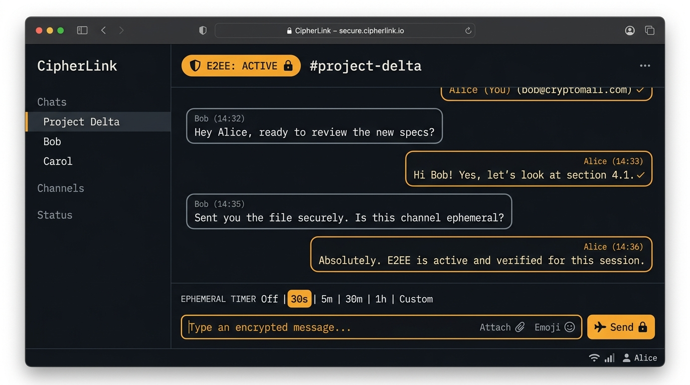

# CipherLink

CipherLink is an accountless, ephemeral, two-person chat app that encrypts messages in your browser before they ever touch the network.

You and a partner pick a shared 3–6 digit PIN. Your browsers derive a shared 256-bit AES-GCM encryption key locally using PBKDF2 via the Web Cryptography API. The backend server is just a minimal WebSocket relay: it routes ciphertext chunks between two clients in the same room. It has no user accounts, no database, no message logs, and no access to your encryption keys.

---

## Screenshot



---

## How It Works

1. **Key Derivation**: When you enter a PIN, your browser runs PBKDF2-HMAC-SHA-256 (120,000 iterations) with a domain-separated salt to generate an AES-256-GCM symmetric key.
2. **Client-Side Encryption**: Every message, image, video, or PDF is encrypted in memory using a unique 96-bit Initialization Vector (IV) and a 128-bit authentication tag before sending.
3. **Dumb-Pipe Relay**: The WebSocket server (`server.ts`) inspects only the room PIN to match two connected peers. It sees only opaque ciphertext blobs.
4. **Zero Persistence**: When both peers disconnect, the in-memory room object is deleted. Nothing is written to disk or database.

---

## Running Locally with Bun

You can run CipherLink locally with [Bun](https://bun.sh/) (version 1.0 or newer).

### 1. Install dependencies

```bash
bun install
```

### 2. Start the development server

```bash
bun dev
```

The app will start at `http://localhost:3000`.

### 3. Test a conversation

1. Open `http://localhost:3000` in two separate browser tabs (or windows).
2. Enter the same PIN in both tabs (for example, `4829`).
3. Send a message from Tab A. You'll see Tab B decrypt and display the message instantly.

### Other useful commands

```bash
# Typecheck
bun run lint

# Production build
bun run build

# Start production server
bun run start
```

---

## How Deployment Works

CipherLink is built as a unified full-stack application where `server.ts` serves the compiled Vite frontend and handles WebSocket connections on `/ws`.

### Hosting Requirements

- **Persistent Process Required**: CipherLink requires a runtime that supports long-lived WebSocket connections (TCP sockets). Platforms like **Render**, **Railway**, **Fly.io**, or any standard VPS/Docker container work out of the box.
- **Serverless Limitation**: Pure serverless platforms (such as Vercel Functions or AWS Lambda) will not work for the backend because serverless instances spin down after seconds and cannot maintain persistent stateful WebSocket servers. If you want to host the frontend on Vercel, you must run `server.ts` separately on a persistent host and point the WebSocket client to that host.

### Production Build & Run

```bash
# 1. Build the frontend
bun run build

# 2. Run the production server
bun run start
```

By default, the server listens on `process.env.PORT` (defaults to `3000`).

A sample `render.yaml` blueprint is included in the repository for one-click deployment on Render.

---

## Known Limitations

We prefer being upfront about what this app does and does not protect against:

- **Short PIN Entropy**: A 3 to 6-digit numeric PIN is convenient for typing into a phone, but it only offers between 1,000 and 1,000,000 possible combinations. While PBKDF2 slows down offline guessing and the relay rate-limits joins, a short PIN is designed for casual rendezvous—not for protecting against a dedicated adversary guessing your PIN in real time. Use a longer PIN for sensitive chats.
- **Screenshots and Shoulder Surfers**: Senders can delete messages, and self-destruct timers (30s, 5m) remove messages from browser memory automatically. However, math cannot prevent the person on the other end from taking a screenshot, taking a photo of their screen with another phone, or copying text before it disappears.
- **Tab Lifetime & Volatile Memory**: Plaintext and encryption keys live strictly in browser RAM. If you refresh the page or close the tab, your chat history is permanently gone. There is no cloud backup, message history, or multi-device sync.
- **Strict Two-Party Cap**: Each room is capped at exactly two connected peers. Third parties attempting to enter an active room are rejected with a `room-full` error. CipherLink is intentionally not a group chat system.
- **In-Memory Server State**: The relay server maintains active room connections purely in memory. If the relay server restarts, active WebSocket connections will drop and require both peers to reconnect.

---

## Repository Structure

```text
├── server.ts          # Express server and WebSocket relay (/ws)
├── src/
│   ├── crypto/        # In-browser AES-GCM and PBKDF2 cryptography
│   ├── components/    # UI views, chat bubbles, composer, and animations
│   ├── types/         # Chat message and protocol type definitions
│   ├── utils/         # Web Audio synthesizer effects
│   ├── App.tsx        # Main application state and session management
│   └── main.tsx       # React entry point
├── public/            # Static assets and screenshot
├── render.yaml        # Infrastructure blueprint for Render
└── package.json       # Project dependencies and scripts
```

---

## License

MIT License. See [LICENSE.md](LICENSE.md) for details.
